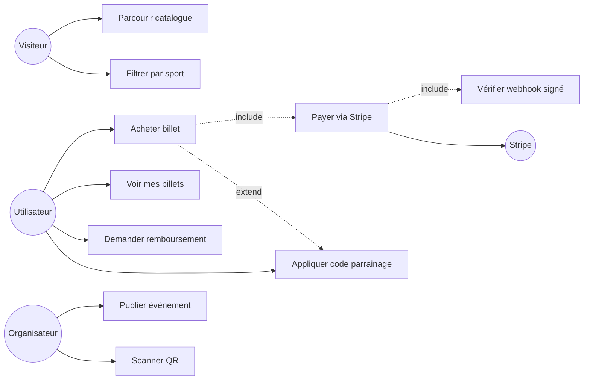

# Cahier des charges 
# ArenaPass - Billetterie

**Auteur** : Fabiola Sainvry, Maxance Zeka

**Mode** : Équipe de 2 

## Table des matières
1. Contexte, problème, public et concurrents
2. Vision, SWOT, personas, 7 P
3. Modèle de paiement
4. User stories, critères d'acceptation, cas d'utilisation
5. Diagrammes de classes et de séquence
6. Maquettes
7. Schéma de base de données
8. Exigences non fonctionnelles
9. Planification et rôles
10. Technologie choisie
11. Journal IA et agent
12. Rédaction et traçabilité

---

## 1. Contexte, problème, public et concurrents

À Montréal, les organisateurs d'événements sportifs de niche galas de boxe, cartes MMA, tournois de jiu-jitsu, karaté, ping-pong, matchs amateurs de foot et basket n'ont pas de plateforme locale pour vendre leurs billets. Ils utilisent Facebook avec des virements Interac (aucune traçabilité), Eventbrite 3,7 % + 1,79 $ par billet, en anglais ou vendent à la porte files d'attente, pas de données. Pour un gala MMA de 300 billets à 45 $$, un organisateur perd environ 1 200 $ en frais Eventbrite et gaspille 15 heures en gestion manuelle.

**Public cible** :
- **Organisateurs** — promoteurs de boxe/MMA, gyms de BJJ, ligues amateures. Besoin : vendre, encaisser vite, contrôler l'entrée.
- **Spectateurs** — 18-45 ans, fans de sports de combat et sports amateurs. Besoin : trouver des événements, acheter en 2 clics, billet mobile.
- **Contrôleurs à l'entrée** — bénévoles. Besoin : scanner les QR sans compte complexe.

**Concurrents** :

| Concurrent | Prix | Faiblesse |
|---|---|---|
| Eventbrite | 3,7 % + 1,79 $/billet | Pas québécois, cher pour petit volume |
| lepointdevente.com | 2 $ + 2 % | Généraliste, pas de sport local |
| Showpass | 2,5 % + 1,50 $ | Surtout concerts et festivals |

**Positionnement** : Centurion Sport Billetterie est la billetterie québécoise pensée pour les événements sportifs locaux, avec des frais fixes bas, une interface bilingue et un QR intégré.

---

## 2. Vision, SWOT, personas et 7 P

**Why** :: Les passionnés de sports de niche à Montréal méritent des événements bien organisés, et les organisateurs ne devraient pas perdre 10 % de leurs revenus en frais étrangers.

**How** :: Plateforme spécialisée, bilingue, paiement unique sans abonnement, frais fixes transparents.

**What** :: Un site web où l'organisateur publie un événement en 5 min et où le spectateur achète en 2 clics.

**SWOT** :
- Forces : spécialisation sport, interface FR/EN native, frais plus bas, QR intégré.
- Faiblesses : nouveau joueur, pas de notoriété, catalogue vide au lancement.
- Opportunités : explosion des gyms MMA/BJJ à MTL, Loi 25 favorise acteurs locaux, demande croissante.
- Menaces : Eventbrite peut baisser ses frais, fraude aux captures de QR, changements aux frais Stripe.

**Personas** :
- **Marc, 34 ans, promoteur MMA.** Organise 4 galas par an. Perd ~1 200 $/gala en frais Eventbrite. Peut payer 500-2 000 $$ en frais par événement, soit 3-5 % du chiffre d'affaires. Volonté forte s'il économise 30 %.
- **Sophie, 26 ans, fan de BJJ.** Va à 8-10 tournois par an. Capable de payer 30-80 $/billet, 1-2 billets par achat. Volonté forte si le paiement est fluide Apple Pay.

**7 P** :
- **Produit** — plateforme de billetterie sport, QR mobile, bilingue.
- **Prix** — frais 1,50 $ + 3 % par billet payés par l'acheteur relié à la section 3.
- **Place** — site web responsive hébergé au Canada idéalement Vercel + Neon.
- **Promotion** — partenariats avec gyms de MMA/BJJ, Instagram, TikTok des organisateurs.
- **Personnes** — équipe réduite, 1 fondatrice-dev, support par courriel.
- **Processus** — publier un événement en 5 min, acheter en 2 clics, scanner à l'entrée.
- **Preuve physique** — reçu PDF par courriel, QR dans le compte, confirmation visible.

---

## 3. Modèle de paiement

**Type** : paiement unique par billet, pas d'abonnement. Je choisis ça parce que le spectateur n'achète qu'occasionnellement et l'organisateur préfère payer juste quand il vend.

**Grille tarifaire** :

| Type d'événement | Prix billet | Frais service | TPS | TVQ | Total acheteur |
|---|---|---|---|---|---|
| Petit tournoi | 15,00 $ | 1,95 $ | 0,85 $ | 1,69 $ | 19,49 $ |
| Match ligue locale | 25,00 $ | 2,25 $ | 1,36 $ | 2,72 $ | 31,33 $ |
| Gala boxe/MMA | 45,00 $ | 2,85 $ | 2,39 $ | 4,77 $ | 55,01 $ |
| Combat premium | 95,00 $ | 4,35 $ | 4,97 $ | 9,92 $ | 114,24 $ |

**Exemple détaillé en cents** (billet 45 $) :
- Prix billet : 45,00 $
- Frais : 3 % × 45,00 + 1,5 = 2,85 $
- Sous-total : 47,85 $
- TPS 5 % = 2,39 $
- TVQ 9,975 % = 4,77 $
- **Total : 5501 cents = 55,01 $**

Les taxes sont arrondies taxe par taxe, pas sur le total.

**Plans** :

| Plan | Pour qui | Prix |
|---|---|---|
| Gratuit | Visiteur | 0 $  navigation, création de compte |
| Payant par billet | Acheteur | Prix + frais  billet QR, reçu PDF, remboursement auto |
| Organisateur | Organisateur vérifié | 1,50 $ + 3 %/billet scan QR, stats, exports CSV |

**Parcours** :
- **Achat** : l'utilisateur clique « Passer au paiement », on crée une commande `PENDING`, Stripe Checkout, retour sur la page de confirmation, le webhook confirme et génère le billet. Règle : la commande passe à `PAID` seulement après webhook signé.
- **Échec** : carte refusée → commande reste `PENDING`, expire dans 15 min, places libérées.
- **Annulation** : avant paiement, l'utilisateur annule son panier → commande `CANCELLED`.
- **Remboursement** : jusqu'à 48 h avant l'événement, 100 % du prix du billet (frais non remboursés). Appel à l'API Stripe Refund.
- **Événement annulé par l'organisateur** : remboursement complet (prix + frais) sous 5 jours ouvrables.

**Programme de parrainage** :
- Code unique par utilisateur (ex. MAX-A3K7).
- Le filleul : 10 % de rabais sur sa première commande (avant taxes).
- Le parrain : 15 % de crédit max 20 $ sur sa prochaine commande, crédité quand le filleul paie.
- Règles : code utilisable 1 seule fois par filleul, crédit expire après 90 jours, max 5 parrainages réussis par mois, non cumulable avec un autre rabais.

---

## 4. User stories, critères d'acceptation et cas d'utilisation

**User stories (priorisées MoSCoW)** :

| ID | Priorité | Story |
|---|---|---|
| US-01 | Must | En tant que visiteur, je veux voir le catalogue sans compte pour trouver ce qui m'intéresse. |
| US-02 | Must | En tant que nouvel utilisateur, je veux créer un compte avec courriel ou Google pour acheter rapidement. |
| US-03 | Must | En tant qu'acheteur, je veux payer un billet avec Stripe pour réserver ma place. |
| US-04 | Must | En tant qu'acheteur, je veux recevoir un billet QR par courriel après paiement pour le présenter à l'entrée. |
| US-05 | Must | En tant qu'utilisateur, je veux voir mes billets dans mon compte pour les retrouver. |
| US-06 | Must | En tant qu'acheteur, je veux demander un remboursement jusqu'à 48 h avant pour récupérer mon argent si besoin. |
| US-07 | Must | En tant que système, je veux traiter les webhooks Stripe signés de manière idempotente pour ne jamais compter deux fois. |
| US-08 | Should | En tant que visiteur, je veux filtrer par sport, date et ville pour gagner du temps. |
| US-09 | Should | En tant que nouveau client, je veux appliquer un code de parrainage pour avoir 10 % de rabais. |
| US-10 | Should | En tant que parrain, je veux recevoir un crédit quand mon filleul paie pour être récompensé. |
| US-11 | Could | En tant qu'organisateur, je veux publier un événement pour vendre mes billets. |
| US-12 | Won't | On n'aura PAS d'app iPhone/Android dans la première version. On va juste faire un site web mobile-friendly qui peut être épinglé à l'écran d'accueil (PWA). Une vraie app sera pour plus tard. |

**Règles métier** :
- RM-01 : montants toujours en cents (`Int`).
- RM-02 : commande passe à `PAID` seulement après webhook signé.
- RM-03 : prix et nom de l'événement figés dans `OrderItem` à l'achat.
- RM-04 : taxes calculées et arrondies taxe par taxe.
- RM-05 : aucun billet émis si événement complet.
- RM-06 : remboursement possible jusqu'à 48 h avant.
- RM-07 : chaque billet a un QR unique (UUID).
- RM-08 : webhooks journalisés dans `WebhookEvent` pour éviter le double traitement.
- RM-09 : commande `PENDING` qui dépasse 15 min devient `EXPIRED`.
- RM-10 : annulation possible tant que `PENDING`.
- RM-11 : si l'événement est annulé par l'organisateur, remboursement total sous 5 jours ouvrables.
- RM-12 : code de parrainage = première commande seulement.
- RM-13 : crédit parrain créé au webhook de paiement du filleul.
- RM-14 : crédit expire en 90 jours.
- RM-15 : max 5 parrainages réussis par mois.
- RM-16 : rabais non cumulables.
- RM-17 : remboursement du filleul dans les 14 jours = crédit parrain annulé.

**Critères d'acceptation** :
- **AC-01 (achat réussi)** — Étant donné un utilisateur connecté avec un billet dans le panier, quand il paye avec `4242 4242 4242 4242`, alors la commande passe à `PAID` après webhook, un billet QR est créé et un courriel est envoyé sous 30 secondes.
- **AC-02 (carte refusée)** — Étant donné un utilisateur qui paye, quand il saisit `4000 0000 0000 0002`, alors Stripe retourne `card_declined`, la commande reste `PENDING`, aucun billet.
- **AC-03 (événement complet)** — Étant donné un événement à capacité atteinte, quand quelqu'un tente d'acheter, alors le bouton est désactivé et affiche « Complet ».
- **AC-04 (remboursement OK)** — Étant donné une commande `PAID` pour un événement dans + de 48 h, quand l'utilisateur demande un remboursement, alors Stripe est appelé, la commande passe à `REFUNDED`, les billets sont invalidés.
- **AC-05 (remboursement refusé)** — Étant donné une commande `PAID` pour un événement dans - de 48 h, quand l'utilisateur tente un remboursement, alors c'est refusé avec le message « Délai de 48 h dépassé ».
- **AC-06 (webhook valide)** — Étant donné un webhook `checkout.session.completed` signé, quand il est reçu, alors la commande passe à `PAID` et l'événement est enregistré ; un second webhook identique est ignoré.
- **AC-07 (webhook invalide)** — Étant donné un webhook sans signature valide, quand il est reçu, alors le serveur retourne 400, aucune donnée modifiée.
- **AC-08 (code parrainage déjà utilisé)** — Étant donné un utilisateur qui a déjà commandé, quand il entre un code de parrainage, alors c'est refusé avec « Réservé à la première commande ».
- **AC-09 (crédit parrain généré)** — Étant donné le webhook payé du filleul, quand il est traité, alors un crédit de 15 % (max 20 $) est créé pour le parrain, expire dans 90 jours, courriel envoyé.
- **AC-10 (rabais non cumulables)** — Étant donné un panier avec rabais parrainage, quand on ajoute un code promo, alors c'est refusé avec « Rabais non cumulables ».

**Diagramme de cas d'utilisation** (Mermaid) :

**Cas « Payer » détaillé** :
- Acteur principal : utilisateur connecté. Acteur système : Stripe.
- Précondition : au moins 1 billet dans le panier, événement pas complet.
- Scénario : (1) clic « Passer au paiement » (2) création d'une commande `PENDING` + session Stripe (3) redirection chez Stripe (4) saisie carte (5) retour sur page confirmation (6) en parallèle, webhook signé reçu, vérifié, commande `PAID`, billets QR créés, courriel envoyé.
- Alternatif : carte refusée → commande reste `PENDING`, expire après 15 min.
- Règles : RM-01, RM-02, RM-04, RM-05, RM-08.

---

## 5. Diagrammes de classes et de séquence

Diagrammes Mermaid complets dans [`docs/classes.md`](./classes.md).

**Classes principales** :
- **User** : courriel, nom, code de parrainage. Peut avoir plusieurs commandes.
- **Event** : titre, sport, date, lieu, capacité, prix en cents, statut.
- **Order** : sous-total, frais, TPS, TVQ, total, statut, identifiant Stripe.
- **OrderItem** : ligne figée (titre et prix copiés au moment de l'achat).
- **Ticket** : QR code unique, statut (valide / utilisé / remboursé).
- **Refund** : montant, identifiant Stripe du remboursement, statut.
- **WebhookEvent** : id = id Stripe, pour détecter les doublons.
- **Referral**, **DiscountCode**, **CreditLedger** : parrainage et crédits.

**Points clés** : montants en cents, `onDelete: Restrict` vers `Order`, identifiants Stripe uniques.

**Séquence du paiement** : l'utilisateur paye sur Stripe, revient sur la page de confirmation, mais la commande n'est confirmée que par le webhook signé reçu en parallèle. Le serveur vérifie la signature avec `stripe.webhooks.constructEvent`, consulte la table `WebhookEvent` pour l'idempotence, puis met à jour la commande et crée les billets.

---

## 6. Maquettes

Les 6 maquettes sont dans [`docs/maquettes/`](./maquettes/). Code HTML source : [`docs/maquettes.html`](./maquettes.html).

1. **accueil.png** — hero, recherche, événements à venir.
2. **tarifs.png** — 3 plans (gratuit / par billet / organisateur).
3. **panier.png** — sous-total, frais, TPS, TVQ, total visibles.
4. **paiement.png** — formulaire Stripe **avec état d'erreur « carte refusée »**.
5. **confirmation.png** — billet avec QR, détail des montants payés.
6. **compte.png** — historique de billets, bouton remboursement.

Thème sombre avec accents orange/rouge (ambiance combat). Les prix avant taxes, les taxes et le total sont toujours affichés.

---

## 7. Schéma de base de données

Schéma complet dans [`prisma/schema.prisma`](../prisma/schema.prisma). Première migration dans [`prisma/migrations/`](../prisma/migrations/).

**Respect de la checklist de la semaine 3** :

| # | Patron | Mise en œuvre |
|---|---|---|
| 1 | Entiers en cents | Tous les montants sont `Int` suffixés `...Cents` |
| 2 | Produit et prix séparés | Prix copié dans `OrderItem.unitPriceCents` à l'achat |
| 3 | Commande figée | `OrderItem.eventTitle` + `unitPriceCents` figés |
| 4 | Machine à états | `OrderStatus`, `TicketStatus`, etc. en `enum` |
| 5 | Abonnement | Non applicable (paiement unique) |
| 6 | On n'efface jamais | `onDelete: Restrict` vers `Order`, table `Refund` séparée |
| 7 | Journal webhooks | `WebhookEvent { id String @id }` sans `@default` |
| 8 | Identifiants externes | `stripe*Id String? @unique` |
| + | Index | `@@index` sur FK et sur `status`, `sport`, `createdAt` |
| + | CHECK | Migration SQL : `CHECK (totalCents = subtotalCents + feesCents + gstCents + qstCents - discountCents)` pour forcer RM-04 |

**Pourquoi en cents ?** Les flottants causent des erreurs (0.1 + 0.2 ≠ 0.3). Les entiers garantissent des calculs exacts.

---

## 8. Exigences non fonctionnelles

**Sécurité** :
- ENF-01 — Aucun numéro de carte stocké chez nous (tout via Stripe Checkout).
- ENF-02 — Webhooks Stripe toujours vérifiés par signature avant traitement.
- ENF-03 — Clés dans `.env`, jamais dans le code, bloquées par `.gitignore`.
- ENF-04 — Mots de passe hachés avec bcrypt.

**Performance** :
- ENF-05 — Catalogue affiché en moins de 2 secondes sur 4G.
- ENF-06 — Page de confirmation répond en moins de 1 seconde après webhook.

**Loi 25** :
- ENF-07 — Collecte minimale : nom, courriel, historique d'achats seulement.
- ENF-08 — Consentement à l'inscription (cases à cocher).
- ENF-09 — Données conservées 3 ans après dernière activité, puis supprimées.
- ENF-10 — Base hébergée chez Neon. Si on utilise la région AWS US East, les données sortent du Québec, ce qui exige une EFVP avant mise en production. On vise une région canadienne.

---

## 9. Planification et rôles

**Rôles** — équipe de 2 personnes :

| Membre | Responsabilités | User stories |
|---|---|---|
| **Fabiola** | Back-end route handlers Next.js, Server Actions, base de données (Prisma + Neon), intégration Stripe (Checkout + webhooks signés), remboursements, tests | US-03, US-06, US-07, US-09, US-10 |
| **Maxance** | Front-end pages Next.js, Tailwind, composants, maquettes finales, authentification NextAuth, catalogue et filtres, UI des billets QR | US-01, US-02, US-04, US-05, US-08, US-11 |

Les deux membres font les revues de code et participent à la rédaction du cahier des charges. La mise en production sur Vercel est faite à deux.

## 10. Technologie choisie

- Front-end : **Next.js 15** App Router, **TypeScript**, **Tailwind CSS**.
- Back-end : route handlers Next.js, Server Actions.
- Base de données : **PostgreSQL** sur **Neon**.
- ORM : **Prisma**.
- Authentification : **NextAuth.js** (Google + courriel).
- Paiement : **Stripe Checkout** + webhooks.
- Déploiement : **Vercel**.

**Justification** : Next.js est recommandé par le prof, toutes les démos Stripe du cours sont faites avec. Prisma + PostgreSQL vus en semaine 3. Stripe Checkout gère la conformité PCI à notre place (ENF-01). Vercel et Neon ont des plans gratuits adaptés à un projet étudiant.

---

## 11. Journal IA et configuration de l'agent

Journal des interactions avec Claude dans [`docs/journal-ia.md`](./journal-ia.md).

Fichier `CLAUDE.md` à la racine : contexte du projet, stack, commandes, règles métier, interdits ne jamais commiter `.env`, ne jamais stocker de carte, ne jamais désactiver la vérification de signature.

Fichier `.claude/settings.json` : interdit à l'agent de lire `.env` et `.env.*`.

---

## 12. Rédaction et traçabilité

- Rédaction en français, identifiants cohérents US, RM, ENF utilisés d'une section à l'autre.
- Commits au format `type: description` 